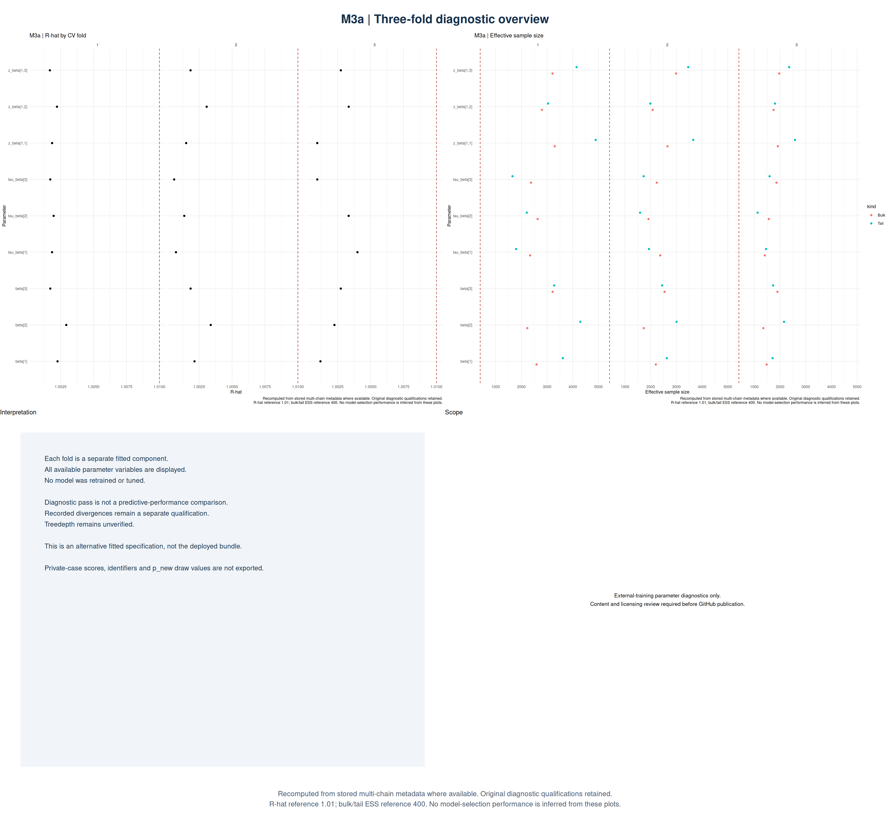
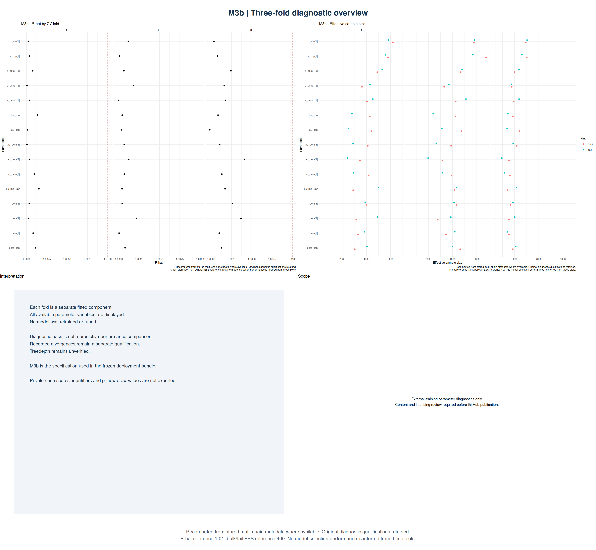

# External training — retained Bayesian models

I use this branch to document the external-model part of my rare-disease evidence pipeline. I trained four Stan specifications and retained three CV fold artifacts per specification. The downstream frozen predictor uses an equal-weight mixture of the three M3b fold components.

## Current import

Four Stan model definitions, checked diagnostic figure candidates, numeric diagnostic records and model pages are included. Training/scoring entrypoints and their full shared-library dependencies will be imported and tested separately. This is not yet a runnable end-to-end checkout.

## M2a

[Model documentation and all three folds](models/m2a/README.md)

## M2b

[Model documentation and all three folds](models/m2b/README.md)

## M3a

[Model documentation and all three folds](models/m3a/README.md)

## M3b

[Model documentation and all three folds](models/m3b/README.md)

## Interpretation

All twelve recorded parameter gates passed the declared thresholds.

Parameter diagnostics are not predictive validation. Recorded divergences remain qualified, treedepth is unverified, and conflicting historical summaries are preserved separately.

Count / draws means recorded divergences divided by retained parameter draws. A verified post-warmup transition rate requires the same retained attempt and unthinned draws.

## OOF evaluation versus new-case inference

An OOF prediction uses the component that excluded the evaluated case from training. The frozen three-component mixture is a distinct predictor for new cases, not the identical OOF predictor or one full-data posterior. Folds are not chains.

## Remaining work

- Import the actual B-stage entrypoints, frozen-CV adapter and complete dependency closure.
- Add tested training, OOF evaluation and frozen-inference instructions.
- Add verified webshot PNG tables; the selector-warning screenshot is not assumed valid.
- Resolve the recorded Tier A release gaps in a separate candidate change.
- Review source, figure labels, data terms and event publication requirements before public release.

Raw chains, RDS bundles, private predictions, private configuration, datasets and original logs are not included. Public training-data origin does not automatically establish redistribution permission.

## AI assistance

I used Perplexity Pro primarily for documentation, debugging and code/workflow integration. I configured the relevant privacy and data-usage settings from the beginning to prevent private data from being used for model training, and I checked those settings throughout the project. I enabled equivalent training-use restrictions from the outset on my other AI accounts.

I will identify any additional contributing providers, products and tiers in my final methods record. This describes the settings I verified; I am not claiming zero retention.

See my [AI assistance disclosure](docs/AI_ASSISTANCE.md).

