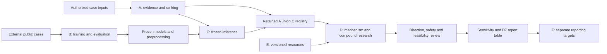
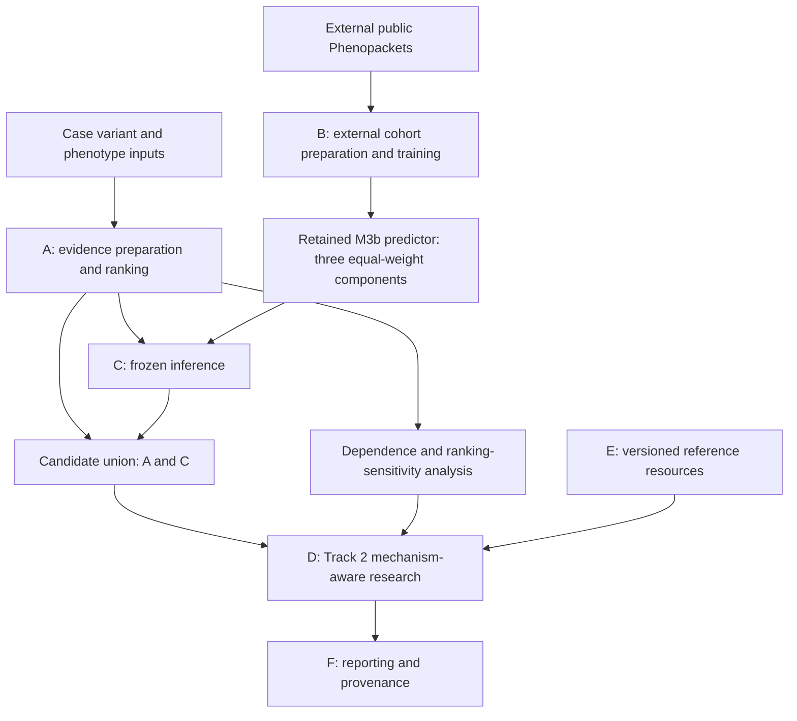

# Rare-Disease Evidence Pipeline

I built this pipeline for the 2026 MVA Hackathon to connect rare-disease gene and variant prioritization with mechanism-led drug-repurposing research. It combines genomic evidence, phenotype similarity, network analysis, and externally trained Bayesian models using R, Python, Stan, and Snakemake.

The workflow emphasizes interpretability: why a candidate ranks highly, which evidence is missing, and how rankings change under alternative assumptions. Case evidence, external model training, frozen inference, and downstream research hypotheses remain distinct, with provenance linking results to their inputs and methods. 

The connected readthrough extension adds transcript-context verification, genomic mapping, published RTDetective prediction lookups, and source-linked literature evidence while keeping computational predictions separate from demonstrated biological effects.


## Track 2 — Drug Repurposing Presentation

<p align="center">
  <strong>Lucas Anderson | LukefromWA | Rare Disease, Real Kid: MVA Hackathon 2026</strong>
</p>

<p align="center">
  <a href="https://youtu.be/o5of9Upa75k">
    
  </a>
</p>

<p align="center">
  <a href="https://youtu.be/o5of9Upa75k">▶ Watch on YouTube</a>
  <br />
  <em>Click the image above to watch the three-minute Track 2 presentation.</em>
</p>


## Start here ##

The project has two connected parts. Track 1 prepares and ranks candidate hypotheses. Track 2 examines their mechanisms and the evidence for possible drug-repurposing hypotheses. I retain the genomic, phenotype, network, and model-based evidence rather than treating their scores as interchangeable.

The current implementation is on the [workflow branch](https://github.com/LukefromWA/rare-disease-evidence-pipeline/tree/workflow). I use this page on `main` for the project overview and methods. The links below lead to the source, execution guides, and checks completed so far.

To run the pipeline, see the [step-by-step run instructions](https://github.com/LukefromWA/rare-disease-evidence-pipeline/blob/workflow/workflow/README.md#how-to-run) and the [CLI guide](https://github.com/LukefromWA/rare-disease-evidence-pipeline/blob/workflow/docs/CLI.md). These cover the configured runtime and required inputs, Track 1, historical candidate handoff preparation, Track 2, independent candidate-gene exploration, continuation, output locations, and CLI tests.

| Looking for | Start with |
|---|---|
| Setup and step-by-step execution | [How to run](https://github.com/LukefromWA/rare-disease-evidence-pipeline/blob/workflow/workflow/README.md#how-to-run) |
| CLI inputs, configuration, paths, and historical handoff preparation | [CLI guide](https://github.com/LukefromWA/rare-disease-evidence-pipeline/blob/workflow/docs/CLI.md) |
| Analysis stages and entrypoints | [Workflow guide](https://github.com/LukefromWA/rare-disease-evidence-pipeline/blob/workflow/workflow/README.md) |
| Master workflow | [workflow/Snakefile](https://github.com/LukefromWA/rare-disease-evidence-pipeline/blob/workflow/workflow/Snakefile) |
| Stage dependencies and commands | [Rule modules](https://github.com/LukefromWA/rare-disease-evidence-pipeline/tree/workflow/workflow/rules) |
| Calculations and shared functions | [Scripts](https://github.com/LukefromWA/rare-disease-evidence-pipeline/tree/workflow/workflow/scripts) and [workflow library](https://github.com/LukefromWA/rare-disease-evidence-pipeline/tree/workflow/workflow/lib) |
| External training and retained-fit records | [external-training branch](https://github.com/LukefromWA/rare-disease-evidence-pipeline/tree/external-training) |
| Standalone ranking-sensitivity analysis | [A11 execution guide](https://github.com/LukefromWA/rare-disease-evidence-pipeline/blob/workflow/docs/A11_REPRODUCIBILITY.md) |
| Software versions and citations | [Software record](docs/SOFTWARE.md) |
| Original source-import checks and reproduction boundary | [Master workflow checkpoint](https://github.com/LukefromWA/rare-disease-evidence-pipeline/blob/workflow/docs/MASTER_WORKFLOW_CHECKPOINT.md) |
## Execution status

The configured Linux/WSL `full_extended` workflow completed a forced
recomputation of all 62 scheduled jobs on 24 October 2026 in 27 minutes
and 38 seconds, including the final completion and integrity audit.

The run covered core candidate analysis, frozen-model scoring, readthrough
routing, transcript-context verification, genomic mapping, external-prediction
lookups, and source-linked claim ledgers.

The run used existing VEP annotations, prepared reference resources, retained
external-model artifacts, and authorized inputs. The recorded duration excludes
installation, initial annotation, external-model training, resource acquisition,
and manual literature curation. It is an observed runtime for the configured
environment, not a clean-install benchmark.

### Core and extended execution

The master workflow applies frozen external-model artifacts without rerunning
B training. Its default `all` target requests resource readiness, A10 ranked
candidates, the selected C4 handoff, and the D7 report table. The `full_extended`
target additionally connects the readthrough, external-prediction, and
claim-ledger stages to the final completion audit.

The CLI Track 1 target includes A11 in fresh-Stan mode. Standalone A11,
optional Track 2 analyses, and PDF reporting have separate execution paths;
completion of the core or extended target does not imply that PDF reporting
was run.

### Earlier CLI validation: historical-handoff route

An earlier CLI validation completed Track 1, an explicitly prepared same-case
historical candidate handoff, and Track 2. The counts below describe that
earlier route, not a breakdown of the later 62-job extended run.

| Stage | Completed steps | Observed elapsed time |
|---|---:|---:|
| Track 1 | 22/22 | 22 minutes, 7 seconds |
| Historical candidate handoff | 2/2 | About 5 seconds |
| Track 2 | 17/17 | 56 seconds |

These are observed single-core execution times, excluding installation,
resource preparation, raw VCF annotation, and manual handoff preparation.
The route was repaired and resumed during validation, so these timings are
historical execution records rather than an uninterrupted runtime benchmark.

### Execution records and setup

Before these analysis runs, the source-import checkpoint produced a successful
39-job Snakemake dry-run plan through A10, C4, and D7. That checkpoint verified
the execution plan without running analysis jobs; the subsequent configured
runs established execution completion.

See the workflow and CLI guides for runtime setup, required inputs, supported
analysis routes, and method-specific availability. Detailed checkpoint records
document execution conditions, environment-restoration status, and integration
test coverage separately from the completed analysis runs.

### Repository map

This tree shows selected paths on the `workflow` branch. It is not the file tree of `main`. Reference bundles, populated private configurations, and case results are kept outside this overview.

```text
rare-disease-evidence-pipeline/          # workflow branch
├── README.md                           # Project overview, methods, and run instructions
├── bin/
│   └── mva                             # Interactive and noninteractive CLI
├── config/
│   ├── a11.example.yaml                # Standalone A11 example
│   └── layer_a.parameters.yaml         # Reviewed Layer A parameter record
├── environment/
│   ├── a11-snakemake-test.requirements.txt
│   └── no-training.renv.lock            # Recorded lean R environment
├── tests/
│   ├── test_cli_interactive.py         # Interactive configuration and path tests
│   └── test_cli_resource_manifest.py   # Resource-manifest regression tests
├── workflow/
│   ├── README.md                       # Workflow guide and step-by-step execution
│   ├── Snakefile                       # No-training master entrypoint
│   ├── track2_genes.Snakefile           # Independent unweighted gene exploration
│   ├── rules/                          # Stage dependencies and commands
│   ├── scripts/                        # Executable analysis stages
│   ├── lib/                            # Shared calculations and validation
│   ├── stan/                           # Bayesian model definitions
│   └── layer_a/
│       └── Snakefile                   # Standalone A11 entrypoint
├── models/                             # Model specifications and interpretation
└── docs/
    ├── CLI.md                          # CLI inputs, boundaries, and historical handoff
    └── ...                             # Methods, validation, and checkpoints
```

### Analysis components

| Component | Scientific role | Main handoff |
|---|---|---|
| A | Prepare case evidence, apply QC, compare phenotype/network views, and rank candidates | Candidate evidence, coverage, rankings, and audit records |
| A11 | Examine ranking sensitivity under specified perturbations | Sensitivity summaries, kept distinct from causal probabilities |
| B | Develop models from external public cases | Frozen models, preprocessing state, and evaluation records |
| C | Apply the frozen feature/model contract without case-specific refitting | Model-based candidate results |
| D | Examine mechanism scenarios, targets, compound evidence, gates, and sensitivity | Qualified research hypotheses |
| E | Prepare and validate reference resources | Versioned resource bundles and readiness records |
| F | Assemble saved outputs and provenance | Reviewable tables, figures, and reports |

### Execution and data flow

I developed the external models separately from the case analysis, then apply the frozen models without refitting them on the case. The diagram shows those relationships; separate reporting and optional analyses are not all included in the master `all` target.



D1 currently carries the configured mechanism priors forward without an evidence-based probability update. D4 combines direction compatibility, pathway overlap, and propagation evidence where available. The other research outputs are not eight active channels in the aggregate score. I distinguish the methods present in the code, the methods enabled for a run, and the checks that have actually completed.

## Repository status and navigation

The sections below explain the scientific methods and assumptions. The execution status above records the configured route I completed; the methods description also includes optional analyses with their own dependencies and validation requirements.

- `main` contains the portfolio overview, model documentation, software record, and development-policy documentation.
- The [workflow branch](https://github.com/LukefromWA/rare-disease-evidence-pipeline/tree/workflow) contains the integrated source and execution records.
- The [external-training branch](https://github.com/LukefromWA/rare-disease-evidence-pipeline/tree/external-training) contains the imported Stan definitions, retained-fit diagnostics, and model documentation.
- [Model documentation](https://github.com/LukefromWA/rare-disease-evidence-pipeline/tree/external-training/models) explains the four fitted specifications.
- [Stan definitions](https://github.com/LukefromWA/rare-disease-evidence-pipeline/tree/external-training/workflow/stan) are the executable reference for the model equations below.
- [Environment records](https://github.com/LukefromWA/rare-disease-evidence-pipeline/tree/external-training/environment) describe the imported training environment.
- [AI assistance disclosure](docs/AI_ASSISTANCE.md) explains how I used AI tools in the project.

The integrated implementation is maintained on the `workflow` branch. The
configured Linux/WSL workflow has completed a forced end-to-end execution
through the core and extended stages, including the final completion and
integrity audit.

Execution requires the documented runtime, reference resources, retained model
artifacts, and authorized case inputs. See the workflow and CLI guides for
setup, supported analysis routes, and method-specific availability.


## Workflow overview

I use A to prepare and rank case evidence, B to develop models from external public data, and C to apply the frozen B artifacts without refitting. The external models are not trained on the hackathon child's genome. Track 2 receives the union of the retained A and C candidates while preserving their separate evidence views. D handles mechanism-aware research, E prepares reference resources, and F assembles reports and provenance.



The union combines candidate registries, not their scores:

```math
\mathcal H_{\mathrm{Track\ 2}}=\mathcal H_A\cup\mathcal H_C.
```

I align candidate identifiers and retain source membership, genomic evidence, coverage, and the separate A/C scores. A-only candidates should not disappear because C lacks a prediction, and different score types should not be treated as equivalent. The diagram summarizes the analysis rather than showing every resource dependency.

## A — Case evidence preparation and ranking

### A0–A3: annotation, evidence extraction and QC

Inputs are authorized variant data, annotation records, phenotype information and configuration. Normalize alleles and genome-build conventions, read annotation schemas from their headers, and join transcript consequences using exact allele/transcript identifiers rather than gene symbols alone.

Retain individual QC flags and exclusion reasons. Thresholds belong in configuration and run manifests, not hidden constants. A shortlist should preserve why a row passed or failed and distinguish transcript-level annotations from candidate-level records.

For allele-fraction analysis, use informative allelic depth consistently:

```math
n_i=AD_{\mathrm{ref},i}+AD_{\mathrm{alt},i},\qquad
\widehat f_i=\frac{AD_{\mathrm{alt},i}}{n_i},\quad n_i>0.
```

Total depth and informative allelic depth need not be identical. Missing annotation or population-frequency information must remain distinguishable from an observed negative result.

Output: a keyed candidate evidence table, transcript provenance, QC flags and an exclusion audit.

### A4: phenotype similarity

Compare the case's observed phenotype terms with gene-associated term sets using a declared ontology and annotation snapshot. Information content gives rarer terms greater specificity:

```math
IC(t)=-\log\frac{n_t}{N},\qquad
s_{\mathrm{Lin}}(a,b)=\frac{2IC(\mathrm{MICA}(a,b))}{IC(a)+IC(b)}.
```

Here, n_t counts annotated entities associated with a term or its descendants in the declared universe. MICA is the most informative common ancestor. Edge cases such as a zero denominator need an explicit implementation convention.

Aggregate term similarities with symmetric best-match average:

```math
\mathrm{BMA}(P,G)=\frac12\left[
\frac1{|P|}\sum_{a\in P}\max_{b\in G}s(a,b)
+\frac1{|G|}\sum_{b\in G}\max_{a\in P}s(a,b)
\right].
```

P is the observed case-term set and G is the gene annotation set. Resnik, depth-based Wu–Palmer and ancestor-set Jaccard are complementary views, not independent confirmations. Missing gene annotations are unscorable coverage, not evidence against the gene.

Output: gene-level similarity views, ranks, annotation coverage and resource provenance.

### A5: network propagation

Use phenotype-derived seeds and, in a separately labeled informed view, a declared prior gene panel. Keep the agnostic view free of that panel. A current top-ranked candidate must not become an undeclared prior seed.

For a column-normalized transition matrix P, seed distribution s, restart probability r and dangling-column indicator d, the build-guide update is:

```math
p_{t+1}=r s+(1-r)\left(Pp_t+s\,d^{\mathsf T}p_t\right).
```

The dangling mass returns to the seed distribution. This equation uses r as restart probability, not damping probability. Record the graph, seed policy and implementation used by each run; corrections must not silently replace historical outputs.

A multiplex view connects network layers while keeping their identities available for comparison. For two layers, one possible declared transition structure is:

```math
T=\begin{pmatrix}
(1-\lambda)P_1&\lambda I\\
\lambda I&(1-\lambda)P_2
\end{pmatrix}.
```

Normalization, common node ordering and dangling handling must be checked. If no valid seeds remain, return an unavailable channel rather than a fabricated zero score.

Output: informed/agnostic network scores, graph coverage and propagation settings.

### A6–A7: multiview comparison and coverage-aware integration

Align genomic, phenotype and network evidence by candidate identity. Agreement statistics describe relationships between views; an integrated rank is not an independent input view.

For channel score s_ik, declared weight w_k and availability M_ik, the available-channel mean is:

```math
\overline S_i=\frac{\sum_k w_k M_{ik}s_{ik}}{\sum_k w_k M_{ik}},
\qquad n_{\mathrm{views},i}=\sum_k M_{ik}.
```

The score is undefined when the denominator is zero. Missing evidence is not replaced with biological negative evidence. Score transformations and percentile universes must be documented before combination.

A declared prior-weighted normalization may then be written:

```math
Q_i=\frac{\alpha_i L_i}{\sum_j\alpha_j L_j}.
```

The meaning of L_i must be stated: a transformed evidence score is not automatically a calibrated likelihood. Report informed and agnostic versions separately. Normalization alone does not make Q_i a clinical posterior probability.

### Dependence and channel attribution

The dependence analysis examines whether phenotype and network evidence overlap. A rank-based Gaussian transform on paired available observations gives:

```math
z_i=\Phi^{-1}\left(\frac{\mathrm{rank}(s_i)}{n+1}\right),
\qquad \widehat\rho=\mathrm{cor}(z^{(H)},z^{(N)}).
```

Declare tie handling and the complete-case sample size. A modest correlation does not prove independence or validate a chosen copula.

Exact Shapley attribution describes each channel's contribution to a declared scoring function v over the available evidence channels K:

```math
\phi_k=\sum_{S\subseteq K\setminus\{k\}}
\frac{|S|!(|K|-|S|-1)!}{|K|!}
\left[v(S\cup\{k\})-v(S)\right].
```

Specify the empty-set and missing-data conventions and check that contributions sum to v(K) minus v(empty). Attribution explains the score function; it does not establish biological causality.

### A8: allele-fraction and mosaicism review

With prior Beta(a_0,b_0) and informative counts:

```math
f_i\mid\mathrm{counts}\sim
\mathrm{Beta}(a_0+AD_{\mathrm{alt},i},b_0+AD_{\mathrm{ref},i}).
```

Report credible intervals and read-level/QC qualifications. A beta-binomial versus fixed heterozygous-binomial comparison is a model comparison, not proof of mosaicism. A low fraction alone does not identify its biological cause.

### A9–A10: robustness summaries and evidence-preserving handoff

Join coverage, allele-fraction review, informed/agnostic rankings and robustness summaries into the retained candidate registry. A gene-level summary must preserve its variant links and aggregation rule; it must not erase distinct alleles or compound-heterozygous hypotheses.

Output: ranked candidates with evidence coverage, assumptions, stability summaries and provenance. Case-derived tables remain inside the authorized analysis boundary unless specifically cleared for the intended export.

## A11 — Ranking sensitivity under declared assumptions

A11 keeps sensitivity results separate from the original evidence scores. Perturb declared weights or assumptions, rerank, and record how often each candidate remains in the top m:

```math
\widehat\pi_i^{(m)}=\frac1B\sum_{b=1}^{B}
\mathbf 1\{\mathrm{rank}_b(i)\le m\}.
```

For two top-m sets with overlap r from n candidates, the Kuncheva index is:

```math
KI=\frac{rn-m^2}{m(n-m)},\qquad 0<m<n.
```

Leave-one-channel-out comparisons measure score and rank changes. Record the perturbation distribution, seed, candidate universe and tie rules. These frequencies describe robustness to the chosen perturbations, not the probability that a candidate is causal.

The build guide also groups stability/influence calculations with the A9 robustness stage; A11 is retained here as the separate sensitivity view in the current repository overview.

## B — External-cohort preparation and model development

I fitted the external models using public training data, not the hackathon child's genomic data. The retained fold artifacts come from that external-training analysis.

### B1–B7: eligibility, labels, group audits and deduplication

Screen and parse source records, distinguish observed from explicitly excluded phenotype terms, normalize gene labels, assess resource mapping, audit repeated case groups, select deterministic representatives, and canonicalize positive labels.

The deduplication contract must record the actual grouping fields, conflict policy, representative-selection rule and exclusion reasons. Publication or phenotype resemblance can require review; a packet identifier alone is not evidence that two records are independent.

Output: external cases, canonical labels, duplicate-group identifiers and auditable inclusion/exclusion records. Duplicate counts and no-overlap conclusions need the corresponding audit records.

### B8 → B10 → B9: candidates, splits, then features

1. B8 constructs candidate sets with a declared negative/background policy and positive-label contract.
2. B10 assigns whole duplicate groups/cases to splits or held-out folds and checks disjointness.
3. B9 fits transformations on the appropriate training partition only, then applies them to held-out rows.

For any held-out partition, require disjoint case and duplicate-group identities from its training partition. Record the actual protocol: a grouped OOF design is not the same as a fixed train/validation/test design.

The guide's gene-frequency feature excludes the training case's own label contribution:

```math
G_{gc}=\log\left(1+\sum_{c'\in\mathcal T,\,c'\ne c}
\mathbf 1\{\mathrm{causal}(c')=g\}\right).
```

Phenotype-overlap, network and interaction features must follow their recorded definitions. A gene-frequency feature is not a raw genomic-evidence channel. Stan accepts X as input; the feature meanings are supplied by the matching preprocessing schema, not inferred from model names.

### B11–B13: four Stan specifications

Each training case has one labeled candidate position within its supplied candidate set I_c. All four models use the same conditional categorical-logit likelihood:

```math
p_{ci}(\theta)=\frac{\exp(\eta_i)}{\sum_{j\in I_c}\exp(\eta_j)},
\qquad
\log L(\theta)=\sum_c\left[\eta_{y_c}-\log\sum_{j\in I_c}e^{\eta_j}\right].
```

Stan's `y_pos` is the local position within a contiguous case segment. These probabilities depend on which candidates were supplied; they are not clinical pathogenicity probabilities.

#### M2a: global feature coefficients

```math
\eta_i=x_i^{\mathsf T}\beta,\qquad
\beta_k\sim\mathcal N(0,s_{\beta,k}^2).
```

M2a has no added copula score. Its declared group and pseudo-observation inputs do not enter this predictor. Omitting a dependence term does not prove empirical independence.

#### M2b: global coefficients with a global copula contribution

Let z_hi and z_ni be inverse-Normal transforms of the supplied HPO/network pseudo-observations. The implemented Gaussian-copula log density is:

```math
\ell_i(\rho)=-\frac12\log(1-\rho^2)
-\frac{\rho^2(z_{hi}^2+z_{ni}^2)-2\rho z_{hi}z_{ni}}{2(1-\rho^2)}.
```

With availability mask m_i and gamma denoting `beta_cop`:

```math
\rho=\tanh(r),\qquad
\eta_i=x_i^{\mathsf T}\beta+\gamma m_i\ell_i(\rho),
```

```math
r\sim\mathcal N(0,s_{\mu\rho}^2),\qquad
\gamma\sim\mathcal N(0,s_\gamma^2),\qquad
\beta_k\sim\mathcal N(0,s_{\beta,k}^2).
```

The raw correlation parameter is `rho_raw`. Correlation and copula utility are global. The utility coefficient is not constrained to be nonnegative.

#### M3a: partially pooled group coefficients

```math
\beta_{gk}=\beta_k+\tau_{\beta,k}z_{\beta,gk},\qquad
\eta_i=\sum_k x_{ik}\beta_{g(i),k},
```

```math
z_{\beta,gk}\sim\mathcal N(0,1),\quad
\beta_k\sim\mathcal N(0,s_{\beta,k}^2),\quad
\tau_{\beta,k}\sim\mathrm{HalfNormal}(s_{\tau\beta,k}).
```

The grouping factor must be declared in the run metadata. M3a adds no copula contribution. For the unseen-group slot `G + 1`, generated quantities sample a population-derived coefficient vector; rows assigned to that slot share it within a posterior draw.

#### M3b: partially pooled coefficients, dependence and copula utility

M3b retains the M3a coefficient hierarchy and adds:

```math
\rho_g=\tanh(\mu_\rho+\tau_\rho z_{\rho,g}),\qquad
\gamma_g=\gamma+\tau_\gamma z_{\gamma,g},
```

```math
\eta_i=\sum_k x_{ik}\beta_{g(i),k}
+\gamma_{g(i)}m_i\ell_i(\rho_{g(i)}).
```

The added priors are:

```math
z_{\rho,g},z_{\gamma,g}\overset{\mathrm{ind}}\sim\mathcal N(0,1),\quad
\mu_\rho\sim\mathcal N(0,s_{\mu\rho}^2),\quad
\gamma\sim\mathcal N(0,s_\gamma^2),
```

```math
\tau_\rho\sim\mathrm{HalfNormal}(s_{\tau\rho}),\qquad
\tau_\gamma\sim\mathrm{HalfNormal}(s_{\tau\gamma}).
```

Here, `mu_rho_raw` is the unconstrained location before the tanh transform; gamma and tau_gamma correspond to `beta_cop` and `tau_cop`. The Stan definitions supply the prior scales as data and include the half-Normal normalization constants. New-group coefficients, correlation and utility are sampled from the fitted populations rather than silently assigned to an existing group.

### Evaluation and optional calibration

Keep held-out candidate recovery, ranking/log-score evaluation and posterior sampling diagnostics separate. Model selection and transformation fitting must not use the held-out evaluation labels. If conformal calibration is enabled, document its calibration set, nonconformity definition and threshold; do not claim coverage without checking the required calibration/selection assumptions and actual evaluation.

R-hat, effective sample size, divergences and treedepth answer different sampling questions. The retained-fit documentation reports divergence qualifications separately and leaves treedepth unverified. Passing retained-parameter thresholds is not evidence of predictive accuracy or complete sampler clearance.

### B14: freezing and the retained predictor

Freeze the feature schema, transformations, group mapping, model definitions, priors/configuration, artifact identifiers and checksums. The documented M3b deployment adapter averages three retained fold-specific predictors equally:

```math
\widehat p_i^{\mathrm{frozen}}=
\frac13\sum_{f=1}^{3}\mathbb E_{\theta_f\mid D_{-f}}[p_i(\theta_f)].
```

Average probabilities after within-case softmax, not coefficient vectors before softmax. This is neither one full-data posterior nor evidence-weighted Bayesian model averaging across the four specifications. An OOF case uses its excluding component, not the new-case mixture of all components.

## C — Frozen inference and candidate comparison

### C1: reproduce the external feature contract

Apply the same feature function and frozen training state used by B9:

```math
X_{B9}=f(\mathrm{external\ candidates};\widehat\psi_{\mathrm{train}}),\qquad
X_{C1}=f(\mathrm{case\ candidates};\widehat\psi_{\mathrm{train}}).
```

The input identities differ; the feature meanings, column order and fitted state must not. Similar column names do not make a phenotype BMA score interchangeable with an overlap feature, or an A integrated score interchangeable with a training gene-frequency prior.

### C2–C3: keep model views distinct

Compare private-case baseline views with frozen external predictions without refitting B. Preserve candidate-set definitions, missingness, posterior uncertainty and unseen-group handling. Candidate-set sizes and construction affect softmax interpretation.

### C4: retain the hypothesis registry

Align views by stable candidate/hypothesis identifiers and retain the declared weighted set, not just rank one. Record the rule producing nonnegative hypothesis weights q_j that sum to one; do not invent combination weights in documentation.

For Track 2, combine the retained A and C registries by their union, preserving source membership and evidence. Duplicate identities need explicit reconciliation, not repeated counting. Missing C predictions are not negative evidence against an A-only hypothesis. The q_j assignment across the union must be declared and checked before downstream scenario weighting.

## D — Mechanism-aware Track 2 exploration

### D0–D2: uncertainty handoff, mechanisms and targets

Expand each retained hypothesis into its applicable mechanism scenarios. Join mechanisms to the matching hypothesis, not an unrestricted cross-join. With declared mechanism prior p0(m|j):

```math
w_{jm}=\frac{q_j\,p_0(m\mid j)}
{\sum_{j',m'}q_{j'}p_0(m'\mid j')}.
```

Keep the declared prior separate from evidence-updated mechanism assessments. Competing loss-of-function, gain-of-function, dominant-negative and unknown states may imply different intervention directions. Every removal or renormalization needs an audit reason.

Map genes to protein/target identifiers using versioned resources, preserving ambiguous mappings and action direction rather than guessing.

### D3.1–D3.8: complementary research methods

1. Target/action queries and direction compatibility.
2. Signature reversal when a suitable expression resource is available.
3. Pathway-based hypotheses using actual pathway evidence.
4. Phenotype/indication similarity when suitable annotations exist.
5. Literature-supported hypotheses with traceable sources.
6. Signed network propagation with uncertainty analysis.
7. Controllability analyses only with a declared model and interpretation.
8. Rescue optimization using its declared upstream method outputs.

Methods return evidence with provenance, or an explicit unavailable/disabled/not-applicable status. A missing data source is not replaced with toy evidence in production.

For pathway target sets T_d and hypothesis-associated pathway genes P_j, a declared overlap score is:

```math
J_{dj}=\frac{|T_d\cap P_j|}{|T_d\cup P_j|}.
```

A signed-propagation contract may use the source-to-target adjacency W:

```math
x_{t+1}=\tanh(\alpha W^{\mathsf T}x_t+x_0).
```

Edge orientation, signs, scale and perturbation definitions must match the implementation. Signed methods require their validation/enablement checks; a simulated rescue score is not evidence of treatment efficacy. Controllability is a separately qualified analysis, not an automatic clinical gate.

### D4–D5: evidence integration and noncompensable gates

Integrate declared evidence families with availability recorded:

```math
S_d=\frac{\sum_f v_f M_{df}e_{df}}{\sum_f v_f M_{df}}.
```

The denominator must be positive. Preserve the number and identity of available families. Do not count mechanism evidence twice by copying it into the pathway family.

Direction compatibility, safety and feasibility remain separate gates. A large aggregate score cannot compensate for a failed gate. Unknown or unconfigured pediatric safety is not a pass. Eligibility labels describe research review, not clinical suitability.

### D6–D7: scenario sensitivity and research reporting

Perturb declared scenario and evidence-family weights, recompute scores, and rank all drugs within each draw. For k selected in configuration:

```math
\widehat\pi_d^{(k)}=\frac1B\sum_{b=1}^{B}
\mathbf1\{\mathrm{rank}_b(d)\le k\}.
```

Report rank ranges, coverage, gating status and assumptions that drive the ranking. These frequencies measure stability under the chosen scenarios; they are not probabilities of benefit. Final outputs remain research hypotheses, not treatment recommendations.

## E — Case-independent reference resources

Prepare versioned ontology, gene/protein mappings, interaction networks, pathway sets, drug-action mappings and safety resources where licensed and configured. Record source, version/date, license, transformations and checksums.

Validate identifier joins, species, edge direction/sign, duplicate/conflicting records and resource readiness. Optional methods stay disabled if their required resource or validation sentinel is absent. A resource checksum establishes identity, not scientific appropriateness or permission to redistribute.

## F — Reporting, provenance and release boundaries

F converts saved results into tables, figures and reports without silently recomputing different scientific results. Each run should record inputs, configuration, software versions, seeds, schema, checksums, exclusions and method status.

Keep these quantities separately labeled:

| Quantity | Interpretation |
|---|---|
| Coverage-aware integrated score | Evidence summary under a declared scaling/weighting rule |
| Prior-weighted normalized score | Conditional on the declared score/likelihood map and prior rule |
| A11 top-m frequency | Robustness under the specified ranking perturbations |
| Stan p_new | Within-case probability over the supplied candidate set |
| Track 2 scenario weight | Declared hypothesis/mechanism weighting |
| Drug top-k frequency | Ranking sensitivity, not efficacy or safety |

Reproduction requires more than matching filenames: check identifiers, schemas, row counts, split/group separation, B9/C1 feature parity, frozen-model behavior and the declared validation outputs.

## Hackathon participation

I developed this project as part of the Hackathon, using the provided data to investigate rare-disease candidate hypotheses and possible directions for drug-repurposing research. The underlying individual-level dataset is not included in this repository.

## Acknowledgement

> This work was made possible through the Hackathon, organized by Sage Bionetworks in partnership with the MVA Society, Hugging Face, and BEACON (The Benchmarking, Evaluation, and Assessment Consortium for Science), with prize sponsorship from AWS and Anthropic. We are deeply grateful to the child and their family who generously contributed their data and their story to advance research into this rare disease. We acknowledge their trust in making this Hackathon possible.

## License and submission reuse

My Hackathon submission is subject to CC BY 4.0, as required by the organizers. The organizers may rerun the submission and share it with the research community, with attribution to me. Third-party software and resources retain their own licenses. See [LICENSE](LICENSE) for the license notice and official terms.

## Intended use

I built this for computational research and human review, not clinical diagnosis or treatment selection. Candidate ranks, allele-fraction models, and drug-repurposing hypotheses do not by themselves establish diagnosis, pathogenicity, mosaicism, causality, safety, or treatment efficacy.
