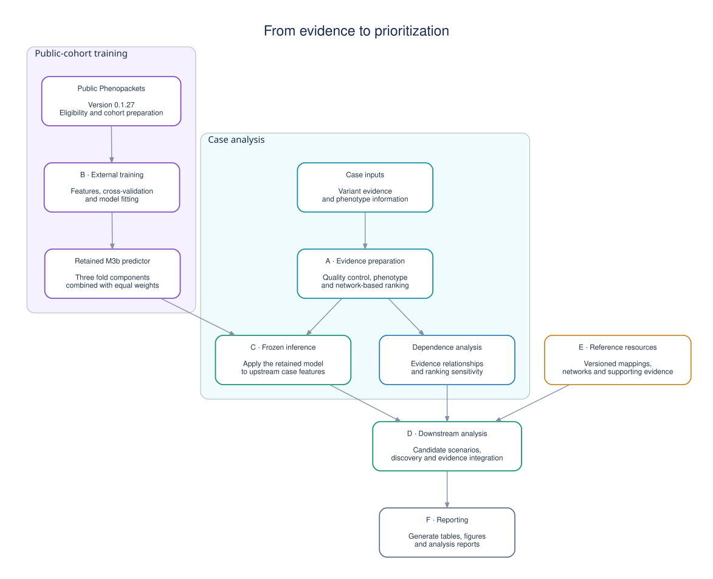
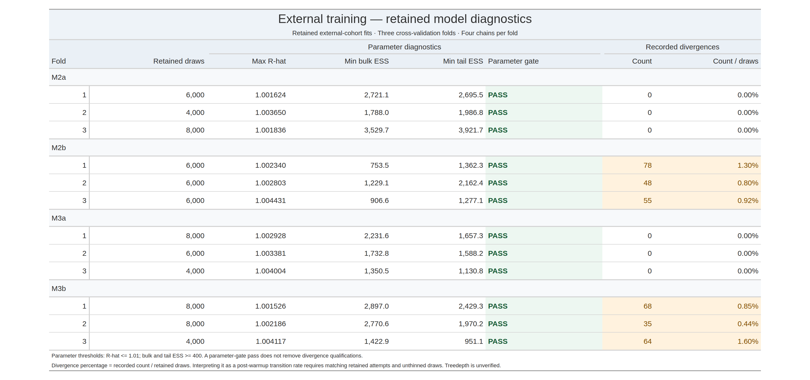

# External training - Bayesian model comparison

I trained four Stan specifications using an external public cohort and retained three cross-validation fits per specification. I use the three retained M3b components as an equal-weight frozen predictor for downstream inference.

<!-- BEGIN WORKFLOW_ARCHITECTURE -->
## How the workflow fits together

The workflow separates external model training from case analysis. Public
Phenopackets provide the training cohort; case-specific evidence enters
through the evidence-preparation layer and is scored using the retained
external predictor.

### A · Evidence preparation and ranking

This layer brings together variant evidence, quality-control results,
phenotype similarity and network scores. It produces ranked candidates
alongside evidence coverage, allele-balance diagnostics and stability
summaries.

### B · External training

The external-training layer prepares the public Phenopacket cohort,
constructs candidate sets and cross-validation splits, and fits the model
specifications. The retained M3b predictor combines three fold components
with equal weights.

### Dependence analysis

A separate analysis examines relationships between evidence sources and
how rankings respond to different weighting and dependence assumptions.
Its evidence tables remain distinct from the externally trained Stan
predictor.

### C · Frozen inference

This layer applies the retained external predictor to features prepared
from the upstream case evidence. It preserves the training–inference
boundary: the private case is not used to refit the Stan models.

### E · Reference resources

Resource preparation provides versioned mappings, networks and supporting
reference data. Source records and checksums identify the snapshots used
by the analysis.

### D · Downstream analysis

This layer carries candidate hypotheses and their evidence into downstream
discovery and integration. It keeps model views distinguishable and
records research eligibility, uncertainty and evidence coverage.

### F · Reporting

The reporting layer turns saved outputs into tables, figures and reports,
keeping the presentation connected to the underlying analysis artifacts.
<!-- END WORKFLOW_ARCHITECTURE -->

## Retained-model diagnostics

I recomputed parameter diagnostics from the retained draws using their stored chain metadata. All twelve model-fold parameter checks passed the declared thresholds. I report the nonzero divergence counts separately, and treedepth remains unverified.

## Model documentation

| Model | Fold diagnostics and plots | Analysis role |
|---|---|---|
| M2a | [Model README](models/m2a/README.md) | Alternative fitted specification |
| M2b | [Model README](models/m2b/README.md) | Alternative fitted specification |
| M3a | [Model README](models/m3a/README.md) | Alternative fitted specification |
| M3b | [Model README](models/m3b/README.md) | Frozen downstream specification |

## Reading the diagnostics

I use R-hat and effective sample size to assess retained parameter draws. I do not treat these checks as predictive-performance comparisons. The divergence percentages use recorded counts divided by retained draws; the same-attempt and unthinned post-warmup assumptions must hold before calling them verified transition rates.

## Evaluation and frozen inference

I distinguish OOF evaluation from new-case scoring. An OOF case is evaluated with the component that excluded it from training. My frozen M3b predictor combines three components for new cases; it is not the identical OOF predictor or one full-data posterior. Each component has four chains.

## Reproduction status

I have included model definitions, diagnostic records and individual fold plots. I am still integrating and verifying the training/scoring entrypoints and their shared dependencies, so this checkout is not yet a complete end-to-end runner. I keep raw training objects and private-case predictions out of this source-and-documentation import.

## AI assistance

I used Perplexity Pro primarily for documentation, debugging and code/workflow integration. I configured the relevant privacy and data-usage settings from the beginning to prevent private data from being used for model training, and I checked those settings throughout the project. I enabled equivalent training-use restrictions from the outset on my other AI accounts.

See my [AI assistance disclosure](docs/AI_ASSISTANCE.md).

<!-- BEGIN MODEL_DOWNLOADS -->
## Retained model downloads

[View the retained-fold release](https://github.com/LukefromWA/rare-disease-evidence-pipeline/releases/tag/retained-folds-v1) for the twelve retained model-fold objects, artifact manifest and SHA-256 checksums. Downloads become available when the draft release is published; repository access permissions apply.
<!-- END MODEL_DOWNLOADS -->
