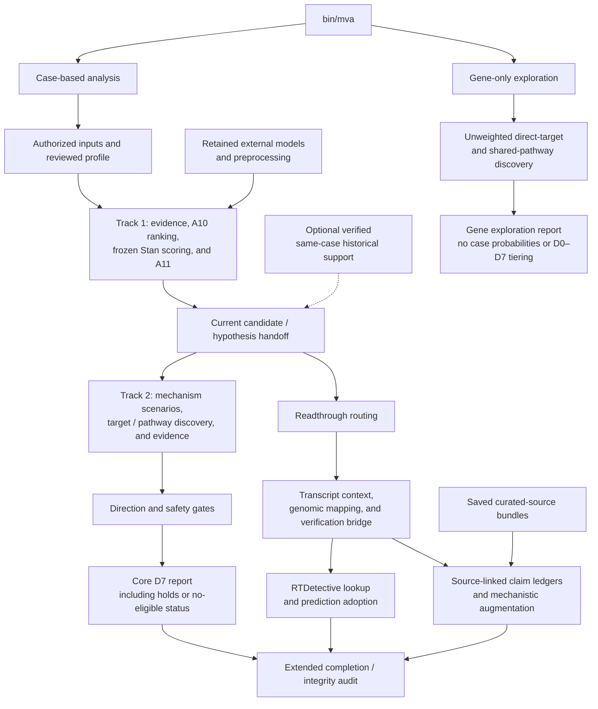

# CLI usage and tested scope

`bin/mva` provides interactive and noninteractive entrypoints for case-based
candidate analysis and drug-repurposing exploration. Scientific calculations
remain in the workflow scripts and shared libraries.

Use the configured Linux/WSL environment with Python, R, Snakemake, and the
required supporting tools on `PATH`. The CLI does not install dependencies,
download all required resources, or replace review of the analysis settings.

## Choose an analysis route

| Route | Purpose | Scope |
|---|---|---|
| Track 1 | Prepare case evidence, rank candidates, apply frozen Stan models, and run A11 | Case-based prioritization and sensitivity analysis |
| Track 2 from an existing run | Continue from a compatible candidate/hypothesis handoff | Mechanism scenarios, evidence discovery, gates, and reporting |
| Connected Track 1 → Track 2 | Build current case outputs and continue through Track 2 | Fresh connected analysis, with optional same-case historical support |
| Gene-only Track 2 | Explore manually supplied candidate genes | Unweighted direct-target and shared-pathway discovery |
| `full_extended` | Add the configured readthrough and evidence-ledger extension | Separate explicit Snakemake target; see the [extended workflow guide](full_extended.md) |

Gene-only exploration is not equivalent to case-based Track 2. The core
workflow and `full_extended` also have different output scopes.

## Analysis routes



Track 1 can run independently. Connected mode continues through the current
handoff into core Track 2; historical support is optional.

The readthrough, prediction-adoption, and claim-ledger branch is requested
through the explicit `full_extended` target described in the
[extended workflow guide](full_extended.md), not implied by ordinary core CLI
execution. These extended outputs do not feed scores back into core ranking.

The diagram summarizes analysis routes, not every rule or resource dependency.
External model fitting is separate from case execution. Completion of the
extended audit is not clinical or biological validation.


## Interactive setup

From the repository root:

```bash
./bin/mva
```

The menu offers:

1. Track 1.
2. Track 2 from an existing run or manually supplied genes.
3. Connected Track 1 → Track 2.

### Required case inputs

New-case setup asks whether raw VCF input and existing VEP output are available.

| Input route | Required inputs |
|---|---|
| Existing VEP output | Indexed annotated `.vcf.gz`, matching index, and the original VEP command/provenance file |
| Raw VCF | Indexed VCF, GRCh38 reference FASTA and index, installed VEP cache, and cache version |

Case setup requires a complete resource/model/analysis profile. Review its QC
thresholds, declared gene priors, mechanism assumptions, and resource paths
before confirming their use. The wizard retains those settings rather than
silently substituting new scientific assumptions.

The wizard checks VCF sample names, records the selected sample and pipeline
label, validates observed HPO terms, and replaces old private case-input fields.
It saves a private `run.yaml`, sample sheet, and phenotype snapshots in a new
workspace outside the source repository.

Fresh connected setup does not require historical case outputs. It offers
verified same-case historical support as an optional input.

Setup defaults to planning. Analysis execution requires explicit confirmation.
Provenance is not fabricated when an input or metadata file is missing.

## Path handling

The CLI accepts Linux paths and Windows drive paths under WSL, including paths
pasted with surrounding quotes. Windows paths are translated using `wslpath`
when available.

- Native Windows workflow execution is not validated.
- Mount network shares first and supply their Linux paths.
- Control characters and commas are rejected because of existing argument
  contracts.
- Quote Windows paths on the command line so Bash preserves backslashes.
- Paths pasted into interactive prompts do not pass through Bash parsing.

Use real local paths in place of the examples below.

## Noninteractive commands

### Track 1

```bash
./bin/mva track1 \
  --config /path/to/workspace/run.yaml \
  --root /path/to/project-data \
  --cores 1 \
  --dry-run
```

### Connected Track 1 → Track 2

```bash
./bin/mva run \
  --config /path/to/workspace/run.yaml \
  --root /path/to/project-data \
  --cores 1 \
  --dry-run
```

### Track 2 from an existing workspace

```bash
./bin/mva track2 \
  --from-run /path/to/case-workspace \
  --root /path/to/project-data \
  --cores 1 \
  --dry-run
```

To select a specific saved configuration:

```bash
./bin/mva track2 \
  --config /path/to/workspace/track2_handoff.yaml \
  --root /path/to/project-data \
  --cores 1 \
  --dry-run
```

Review each plan before repeating the command without `--dry-run`.

### Independent gene-only exploration

```bash
./bin/mva track2 \
  --genes TP53 BRCA1 \
  --resources /path/to/validated-core-resources \
  --hierarchy /path/to/matching-reactome-hierarchy \
  --out /path/to/new-gene-run \
  --cores 1 \
  --dry-run
```

A gene-only dry run creates the saved configuration but does not execute
discovery. Continue that saved run with:

```bash
./bin/mva resume \
  --config /path/to/new-gene-run/run.yaml
```

Alternatively, omit `--dry-run` on the initial command and choose a new output
directory.

For case-based master runs, select `track1`, `track2`, or `run` explicitly when
continuing a saved configuration. Generated master configurations record the
project root, so it need not be re-entered.

## Analysis boundaries

### Case-based analysis

Track 1 requests A10 rankings, frozen Stan predictions, and A11 directly.
Connected mode builds the current case handoff without requiring historical
candidate inputs.

When historical support is explicitly configured, the adapter validates its
manifest, genome-build declarations, and recorded input checksums. Checksum
agreement does not establish case identity; that requires separate verification.

External model training is not performed by these CLI routes. Frozen artifacts
are applied without case-specific refitting.

Family-history terms are stored separately. Their retention does not imply
that they enter the current proband-only phenotype calculation.

### Gene-only exploration

Gene-only mode reuses D2 direct-target and shared-pathway discovery. It does not
create variant coordinates, causal probabilities, Stan scores, or mechanism
weights.

Unmapped inputs remain explicit. The report describes unweighted associations,
not case-based D0–D7 research tiering. This route does not perform
mechanism-specific evidence imports, label review, or safety adjudication.

## Extended readthrough and evidence-ledger workflow

The default core workflow and the explicit `full_extended` target have
different scopes. Ordinary core CLI execution should not be interpreted as
execution of every extension.

The extended target connects:

- Primary and multiview readthrough routing.
- Transcript-specific coding-sequence context verification.
- Exact-allele and genomic reference-window mapping checks.
- Context/mapping identity and provenance verification.
- Published RTDetective prediction-track lookup and adoption.
- Source-linked claim ledgers and mechanistic-source augmentation.
- A final completion/integrity audit.

See [Full extended workflow](full_extended.md) for its typed configuration
overlay, resource requirements, supported variant scope, reference-retrieval
privacy considerations, and execution instructions.

Extended prediction records and curated claims remain separate from the core
D7 ranking. They do not feed prediction scores back into core integration or
change hypothesis weights.

## Validation record

### Completed configured execution

A configured Linux/WSL `full_extended` run completed a forced recomputation of
62 scheduled jobs in 27 minutes 38 seconds, including the final
completion/integrity audit.

The run used existing VEP annotations, reference inputs, retained external
models, local prediction tracks, and saved curated-source bundles. Its elapsed
time excludes initial annotation, external model training, resource acquisition,
and manual literature curation. It is an observed configured-run duration, not
a clean-install or cross-machine benchmark.

The audit establishes its declared integrity, identity, coverage, and
completion checks—not biological accuracy, independent scientific adjudication,
or clinical suitability.

### Earlier CLI validation

Earlier local validation demonstrated existing-case CLI dispatch, gene-only
discovery, and content-identical weighted D2 regression. The configured backend
was repaired and resumed during that validation.

Relevant regression tests include:

- `tests/test_cli_resource_manifest.py`
- `tests/test_cli_interactive.py`

Raw VCF-to-VEP execution and full interactive end-to-end execution still require
dedicated integration tests. Configuration tests, syntax checks, and a successful
backend run do not independently validate every interactive path or establish
fresh-checkout reproduction.

## Repository organization

| Location | Role |
|---|---|
| `bin/mva` | Interactive and noninteractive CLI |
| `workflow/Snakefile` | Canonical configured no-training master |
| `workflow/track2_genes.Snakefile` | Independent unweighted gene exploration |
| `workflow/layer_a/Snakefile` | Standalone A11 sensitivity/reporting |
| `workflow/rules/` | Dependencies and execution commands |
| `workflow/scripts/` | Executable analysis stages |
| `workflow/lib/` | Shared calculations and validation |

The standalone A11 entrypoint is not another complete Layer A runner.
The scientific script and library locations remain stable.

## Optional same-case historical handoff preparation

This section documents the earlier tested route that adds verified same-case
historical candidates after Track 1. It is not required for fresh-only connected
analysis.

Earlier observed execution times were approximately 22 minutes for Track 1,
5 seconds for handoff construction, and 1 minute for Track 2, using one core and
prepared local resources. These describe that earlier route, not the later
forced extended run.

### 1. Verify the historical source

Use historical C4/A10 files from the same case. The historical union directory
must contain `manifest.json` with:

- Version `A10_C4_union_Stan_v1_2`.
- `current_build` and `legacy_build` both set to `GRCh38`.
- Exactly one `legacy_c4` and one `legacy_a10` input entry.
- SHA-256 values matching those input files.

Confirm case identity separately from checksum verification.

### 2. Save a handoff configuration

Keep the completed Track 1 `run.yaml` unchanged. Copy its full configuration to
a private `track2_handoff.yaml` and set the sample-specific historical source:

```yaml
track2:
  frozen_union_dirs:
    SAMPLE_LABEL: /path/to/verified-historical-union
```

Merge this setting into the existing `track2` section. This fragment is not a
complete configuration.

Keep the sample label, output root, and other analysis settings unchanged.
Verify that only the intended historical-source setting differs.

### 3. Build the handoff from completed Track 1 outputs

Activate the configured runtime and set:

```bash
export MVA_ROOT=/path/to/project-data
export MVA_CONFIG=/path/to/workspace/track2_handoff.yaml
export MVA_REPO=/path/to/repository
```

Preview the restricted handoff build:

```bash
snakemake \
  --snakefile "$MVA_REPO/workflow/Snakefile" \
  --directory "$MVA_ROOT" \
  --cores 1 \
  --printshellcmds \
  --dry-run \
  layer_c \
  --allowed-rules c4_fresh_stan_union layer_c
```

The plan should contain only `c4_fresh_stan_union` and `layer_c`. This restricted
build reuses completed Track 1 artifacts; it is not a substitute for producing
or validating them.

Check that their configuration and provenance match the intended analysis. If
the plan differs from the expected scope, inspect it before executing.

Execute the reviewed plan:

```bash
snakemake \
  --snakefile "$MVA_REPO/workflow/Snakefile" \
  --directory "$MVA_ROOT" \
  --cores 1 \
  --printshellcmds \
  --rerun-incomplete \
  layer_c \
  --allowed-rules c4_fresh_stan_union layer_c
```

This constructs a new handoff using the current run's rankings and predictions.
Do not copy an older run's scored union into the new results directory.

### 4. Run Track 2

```bash
"$MVA_REPO/bin/mva" track2 \
  --config "$MVA_CONFIG" \
  --root "$MVA_ROOT" \
  --cores 1
```

This route checks the handoff and resources before executing Layer D.
The existing-run wizard does not automatically perform the optional historical
preparation described above.

## Inspect results

Case outputs are under the configured output root and sample label.

| Output | Location |
|---|---|
| A10 ranked candidates | `a10/ranked_candidates.tsv.gz` |
| Frozen Stan summary | `c3_stan_cv/stan_cv_predictions_summary.tsv` |
| A11 sensitivity results and provenance | `a11_review/calculation/` |
| Current candidate/hypothesis handoff | `c4_stan_union/` |
| Method availability and status | `d3/*status.tsv` |
| Held/excluded rows and reasons | `d5/held_or_excluded.tsv` |
| Sensitivity-stage status | `d6/status.tsv` |
| Scenario coverage | `d6/scenario_coverage.tsv` |
| Core Track 2 report | `d7/final_report.tsv` |
| Extended completion audit, when requested | `extended/run_audit.json` |
| Execution logs | `logs/` |

Optional methods record unavailable, disabled, or not-applicable states.
Successful stage execution does not mean that every method produced usable
evidence.

A report with no eligible drugs is a valid screening outcome. Inspect coverage,
holds, and exclusions rather than assuming that a final eligible-drug ranking
must exist.

