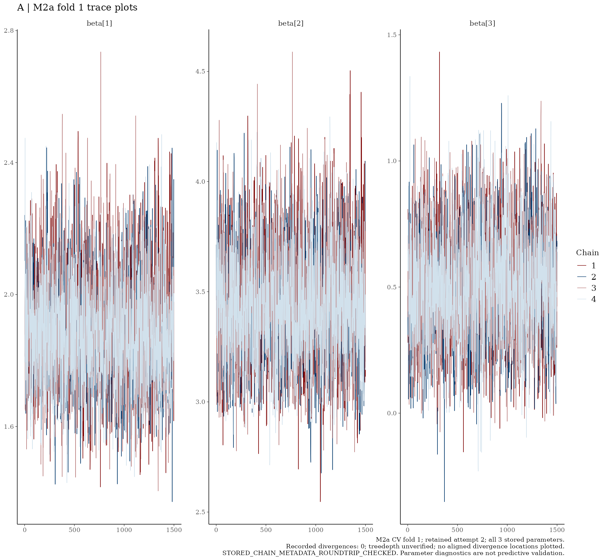
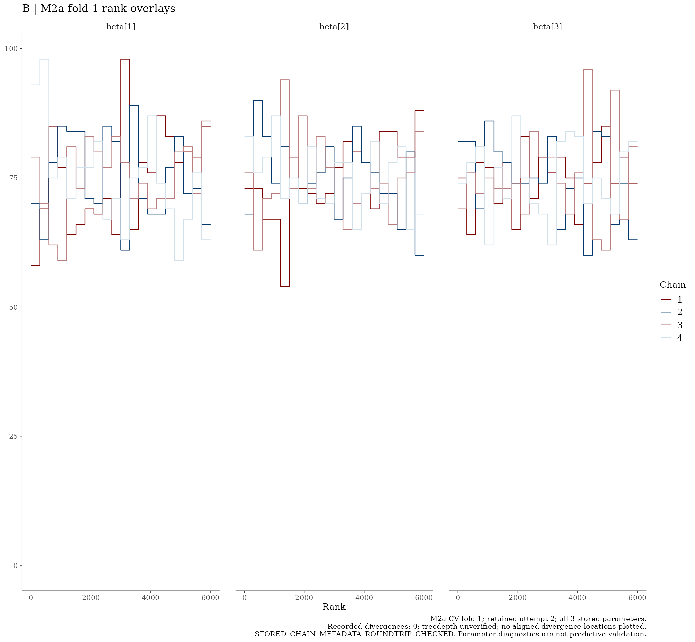
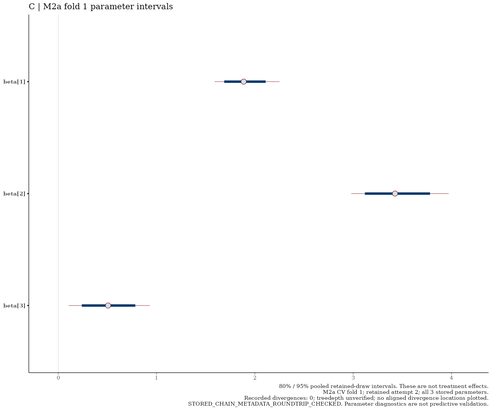

# M2a — CV fold 1

I report this retained fold without refitting.

[Back to the model README](../../README.md)

## Combined diagnostic panel

## Trace plots

## Rank overlays

## Parameter intervals

I keep parameter diagnostics separate from predictive validation. I retain the recorded divergence qualifications and unverified treedepth status. The three CV folds are separate fits, not chains.
