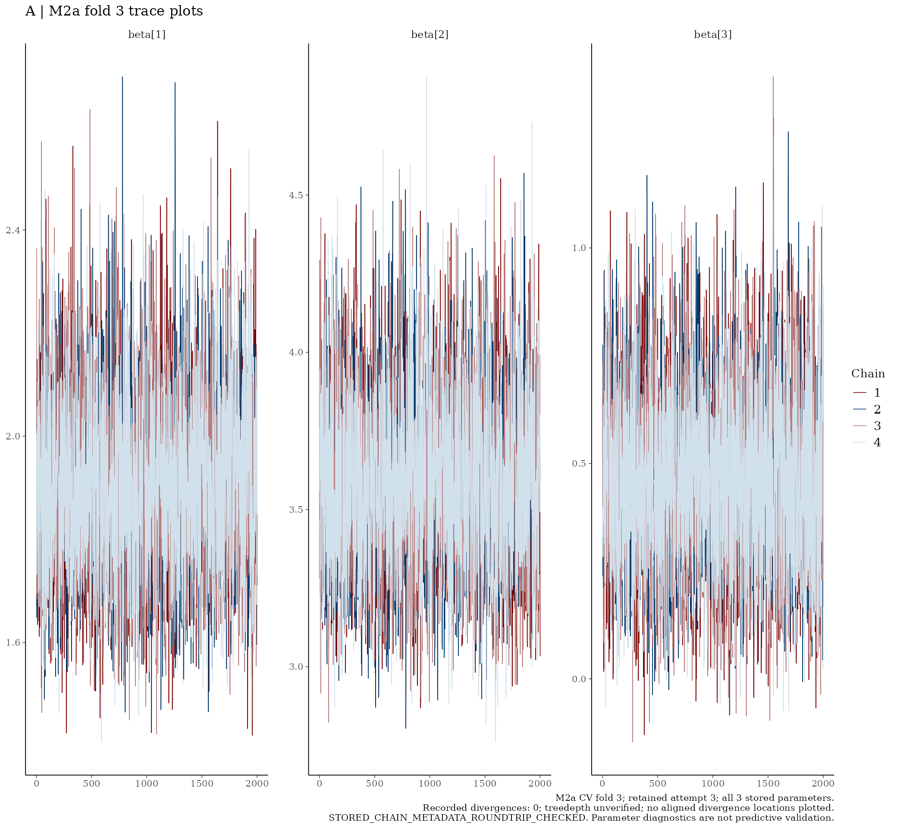
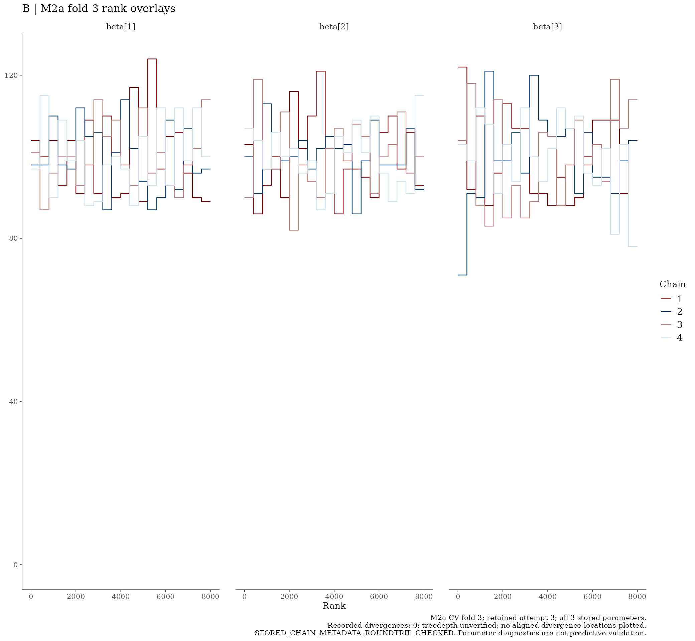
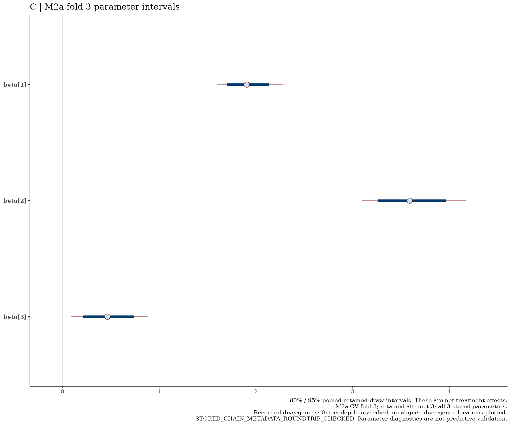

# M2a — CV fold 3

I show the retained parameter draws below without refitting.

[Back to the model README](../../README.md)

## Trace plots

## Rank overlays

## Parameter intervals

I interpret the plots alongside the model diagnostic table. Parameter intervals are not clinical treatment-effect estimates; the recorded divergence and treedepth qualifications still apply.

<!-- BEGIN RETAINED_ARTIFACT -->
## Retained artifact

- Retained object: `m2a_fold03.rds`
- Size: 588,852,070 bytes
- SHA-256: `c79e7cd4e8524028a2e411695b0b03fdfadfaf7b2583ce10ec7434d6270d0376`

[Download this retained fold](https://github.com/LukefromWA/rare-disease-evidence-pipeline/releases/download/retained-folds-v1/m2a_fold03.rds) · [Release and checksums](https://github.com/LukefromWA/rare-disease-evidence-pipeline/releases/tag/retained-folds-v1)

The files are distributed separately from the Git source checkout.
See the [artifact guide](../../../../docs/retained-artifacts.md).
Download links become available when the draft release is published;
repository access permissions apply.
<!-- END RETAINED_ARTIFACT -->
