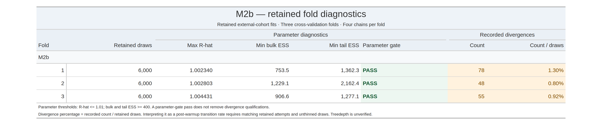

# M2b — retained external-training fits

I report the three retained CV fold fits for M2b here. Each fit has four chains.

[Stan model source](../../workflow/stan/m2b.stan)

## Fold diagnostic table

I report the retained-parameter diagnostics and recorded divergence counts separately. Treedepth remains unverified. The table percentage is recorded divergences divided by retained draws, not an independently verified transition-rate audit.

## Individual fold plots

- [Fold 1: trace, rank and interval plots](folds/fold01/README.md)
- [Fold 2: trace, rank and interval plots](folds/fold02/README.md)
- [Fold 3: trace, rank and interval plots](folds/fold03/README.md)

## Analysis role

I fitted this alternative specification; I did not package it as the M3b deployment mixture.

## Reproduction status

The source snapshot includes Stan model definitions, retained-fit
diagnostic records and fold-level plots. Retained RDS model objects are
distributed separately as release attachments, alongside an asset
inventory and SHA-256 checksums.

The integrated workflow has been run locally. This tagged snapshot is
a source-and-documentation snapshot, not a complete reproduction of
that local environment. Reproduction requires the matching workflow
source, dependencies, configuration and authorized inputs. Private
case inputs and predictions are not included.
