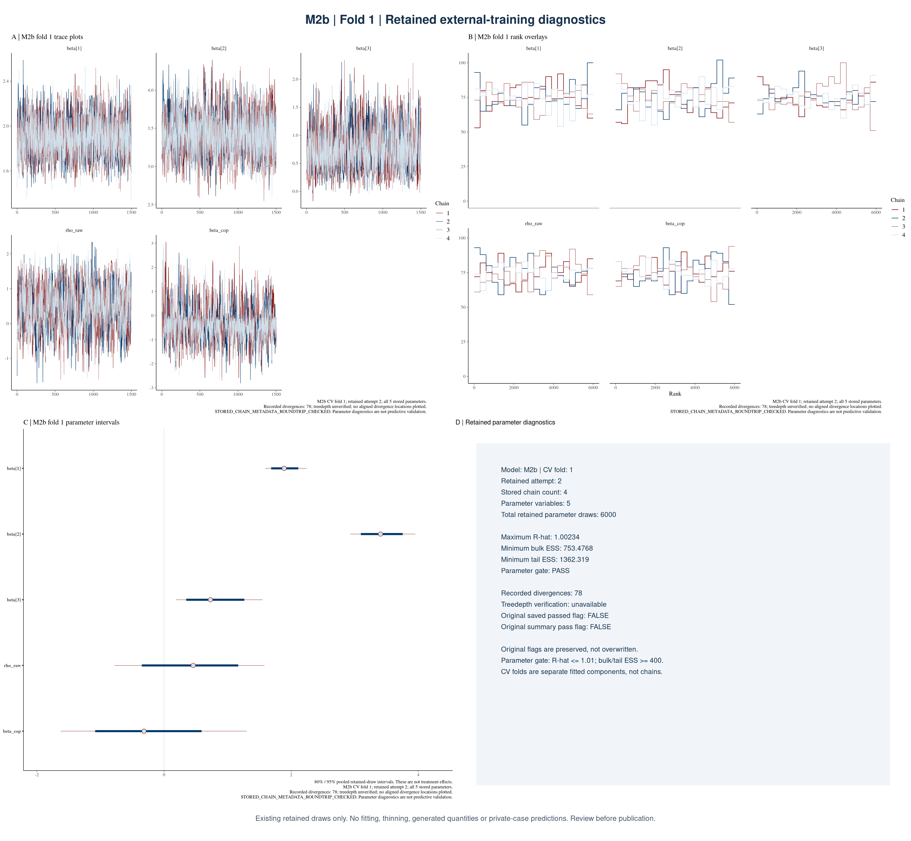
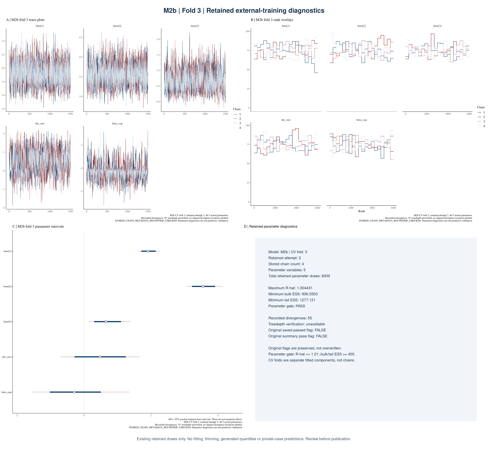

# M2b — retained external-training fits

[Stan model source](../../workflow/stan/m2b.stan)

## Diagnostic values

| Fold | Attempt | Chains | Draws | Max R-hat | Min bulk ESS | Min tail ESS | Parameter gate | Divergences | Count / draws |
|---:|---:|---:|---:|---:|---:|---:|---|---:|---:|
| 1 | 2 | 4 | 6,000 | 1.002340 | 753.5 | 1362.3 | PASS | 78 | 1.30% |
| 2 | 2 | 4 | 6,000 | 1.002803 | 1229.1 | 2162.4 | PASS | 48 | 0.80% |
| 3 | 2 | 4 | 6,000 | 1.004431 | 906.6 | 1277.1 | PASS | 55 | 0.92% |

Parameter diagnostics are not predictive validation. Recorded divergences remain qualified, treedepth is unverified, and conflicting historical summaries are preserved separately.

Count / draws means recorded divergences divided by retained parameter draws. A verified post-warmup transition rate requires the same retained attempt and unthinned draws.

## Overview

## Fold 1

[Trace](figures/m2b_fold01_trace.png) · [Rank](figures/m2b_fold01_rank.png) · [Intervals](figures/m2b_fold01_intervals.png)

## Fold 2

[Trace](figures/m2b_fold02_trace.png) · [Rank](figures/m2b_fold02_rank.png) · [Intervals](figures/m2b_fold02_intervals.png)

## Fold 3

[Trace](figures/m2b_fold03_trace.png) · [Rank](figures/m2b_fold03_rank.png) · [Intervals](figures/m2b_fold03_intervals.png)

## Analysis role

Alternative fitted specification; not the model packaged in the M3b deployment bundle.

Each CV fold is a separate fit with its own chains. This batch does not yet include verified training/scoring entrypoints or their full dependency closure. No complete run command is claimed. PNG table export remains a separate reviewed addition.

## Individual fold pages

- [Fold 1: panel and individual plots](folds/fold01/README.md)
- [Fold 2: panel and individual plots](folds/fold02/README.md)
- [Fold 3: panel and individual plots](folds/fold03/README.md)
