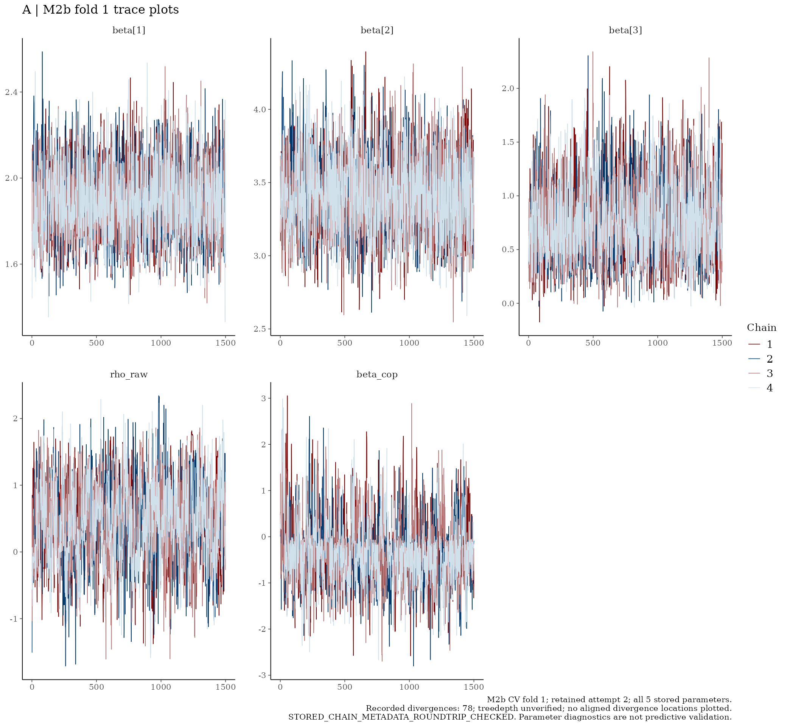
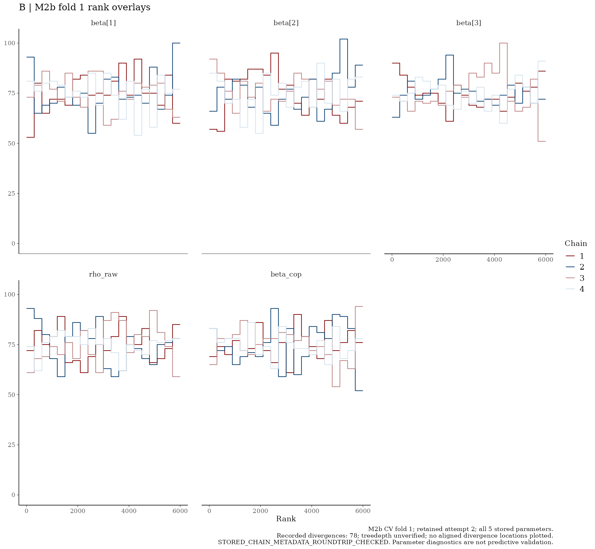
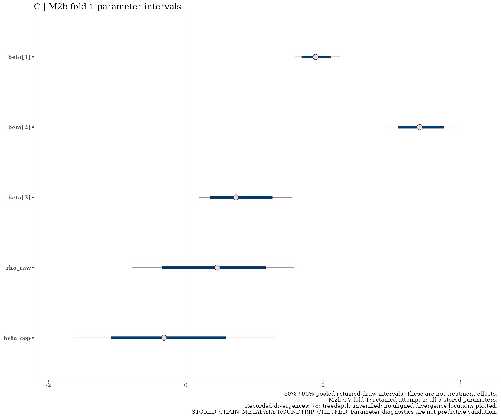

# M2b — CV fold 1

I show the retained parameter draws below without refitting.

[Back to the model README](../../README.md)

## Trace plots

## Rank overlays

## Parameter intervals

I interpret the plots alongside the model diagnostic table. Parameter intervals are not clinical treatment-effect estimates; the recorded divergence and treedepth qualifications still apply.
