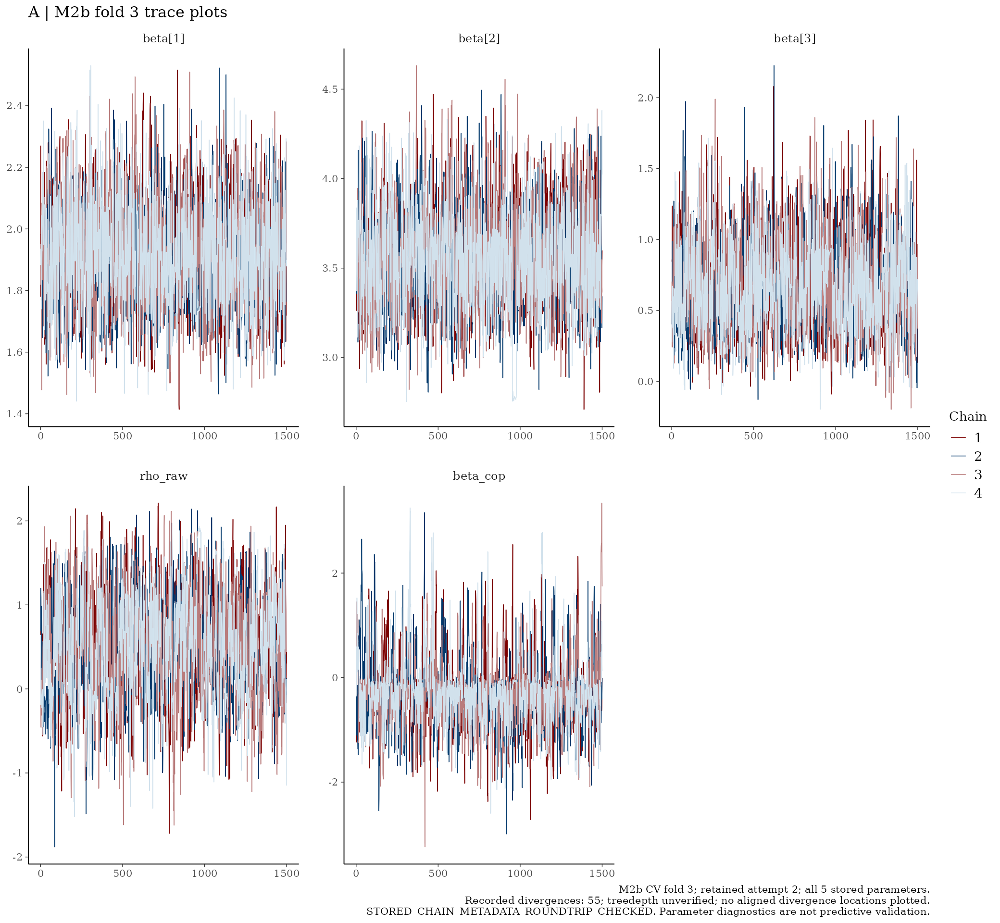
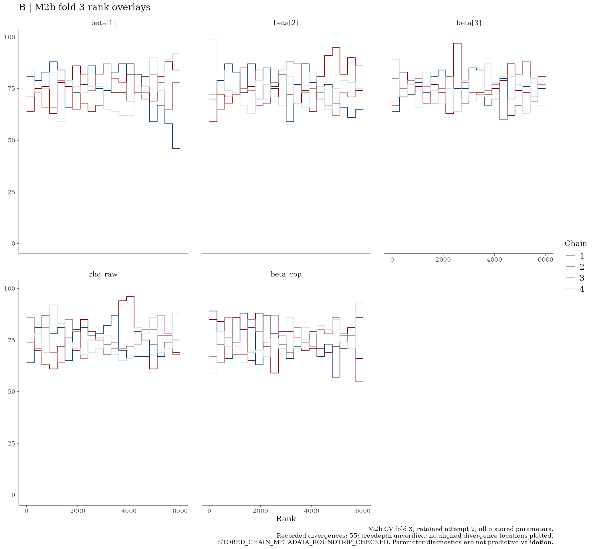
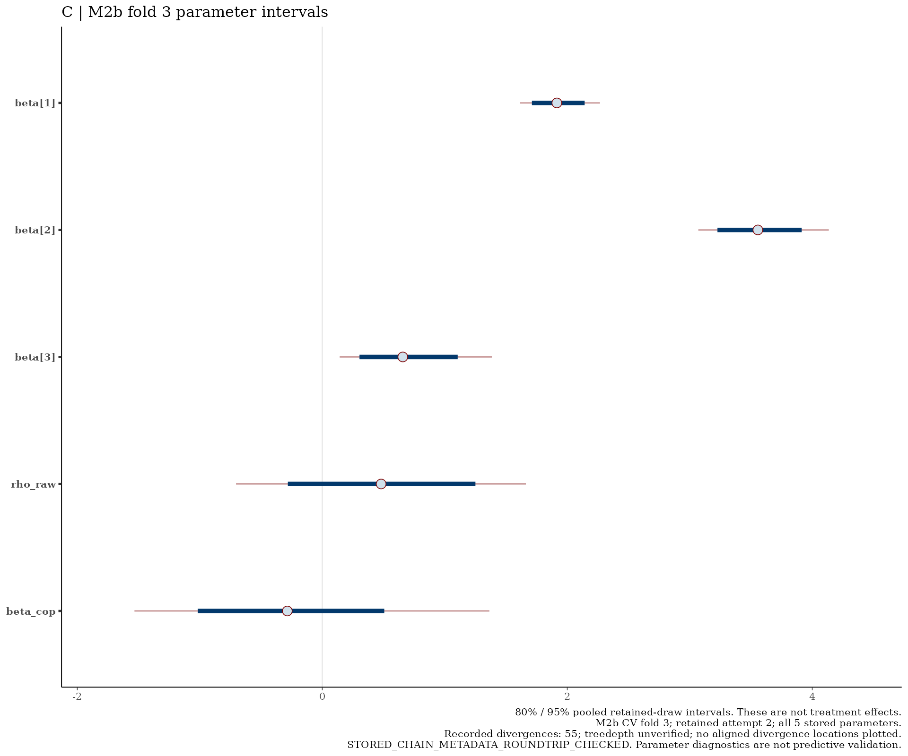

# M2b — CV fold 3

I show the retained parameter draws below without refitting.

[Back to the model README](../../README.md)

## Trace plots

## Rank overlays

## Parameter intervals

I interpret the plots alongside the model diagnostic table. Parameter intervals are not clinical treatment-effect estimates; the recorded divergence and treedepth qualifications still apply.

<!-- BEGIN RETAINED_ARTIFACT -->
## Retained artifact

- Retained object: `m2b_fold03.rds`
- Size: 442,374,345 bytes
- SHA-256: `b4edba1ccd4c6aee885a51e019d9aa6fe37f326aff7e42d0286be5f0345fe13d`

[Download this retained fold](https://github.com/LukefromWA/rare-disease-evidence-pipeline/releases/download/retained-folds-v1/m2b_fold03.rds) · [Release and checksums](https://github.com/LukefromWA/rare-disease-evidence-pipeline/releases/tag/retained-folds-v1)

The files are distributed separately from the Git source checkout.
See the [artifact guide](../../../../docs/retained-artifacts.md).
Download links become available when the draft release is published;
repository access permissions apply.
<!-- END RETAINED_ARTIFACT -->
