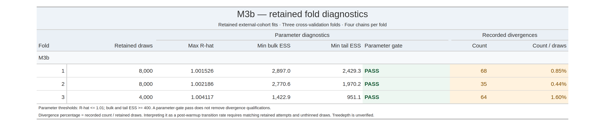

# M3b — retained external-training fits

I report the three retained CV fold fits for M3b here. Each fit has four chains.

[Stan model source](../../workflow/stan/m3b.stan)

## Fold diagnostic table

I report the retained-parameter diagnostics and recorded divergence counts separately. Treedepth remains unverified. The table percentage is recorded divergences divided by retained draws, not an independently verified transition-rate audit.

## Individual fold plots

- [Fold 1: trace, rank and interval plots](folds/fold01/README.md)
- [Fold 2: trace, rank and interval plots](folds/fold02/README.md)
- [Fold 3: trace, rank and interval plots](folds/fold03/README.md)

## Analysis role

I use three retained M3b fold components in my frozen equal-weight predictive mixture.

## Reproduction status

I have included the Stan definition and diagnostic outputs. I am still integrating the tested training/scoring entrypoints and their shared dependencies into this checkout.
