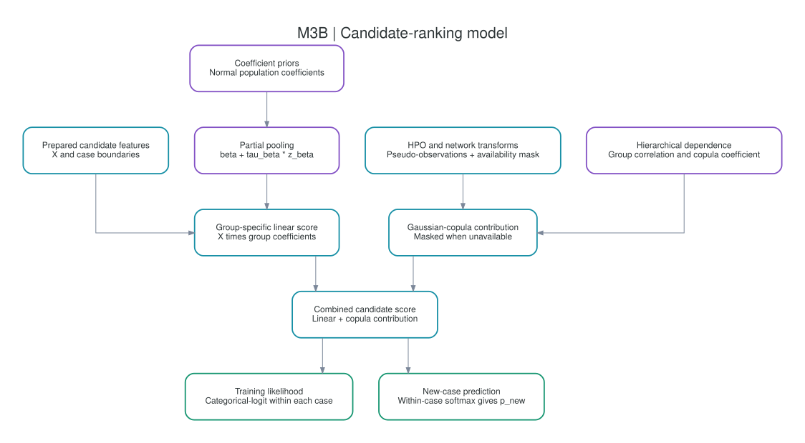

# M3b — retained external-training fits

I report the three retained CV fold fits for M3b here. Each fit has four chains.

[Stan model source](../../workflow/stan/m3b.stan)

## Fold diagnostic table

I report the retained-parameter diagnostics and recorded divergence counts separately. Treedepth remains unverified. The table percentage is recorded divergences divided by retained draws, not an independently verified transition-rate audit.

## Individual fold plots

- [Fold 1: trace, rank and interval plots](folds/fold01/README.md)
- [Fold 2: trace, rank and interval plots](folds/fold02/README.md)
- [Fold 3: trace, rank and interval plots](folds/fold03/README.md)

## Analysis role

I use three retained M3b fold components in my frozen equal-weight predictive mixture.

## Reproduction status

I have included the Stan definition and diagnostic outputs. I am still integrating the tested training/scoring entrypoints and their shared dependencies into this checkout.

<!-- BEGIN MODEL_ARCHITECTURE -->
## Model structure

### Partially pooled coefficients and dependence

Both the feature coefficients and the copula contribution vary by group under population-level priors. The model uses non-centered parameterizations.

\[
\eta_i = x_i^{\mathsf T}\beta_{g(i)} + b_{\mathrm{cop},g(i)}\,m_i\log c_{\rho_{g(i)}}(u_{H,i},u_{N,i}).
\]

Here, `X` is the prepared feature matrix. For the copula specifications, the HPO/network pseudo-observations are separate inputs, and `m_i` is the availability mask. Feature meanings and column order come from the matching preprocessing record, not the Stan filename.

### Likelihood and prediction

Training uses a categorical-logit likelihood over the candidate set within each case, with `y_pos` identifying the single labeled candidate. Generated quantities apply a within-case softmax to new candidate scores and return `p_new`. These probabilities are conditional on the supplied candidate set, not clinical pathogenicity probabilities.

### Parameters and priors

`beta`, `mu_rho_raw`, and `beta_cop` have zero-centered Normal priors. `z_beta`, `z_rho`, and `z_cop` have standard Normal priors. The nonnegative scales `tau_beta`, `tau_rho`, and `tau_cop` have half-Normal priors.

[Read the executable Stan definition](../../workflow/stan/m3b.stan).

For a new group, generated quantities draw new group effects from the population distribution. The retained run metadata determines which groups were actually fitted.

### Retained downstream predictor

The downstream predictor combines the three retained M3b fold components with equal weights. It is a predictive mixture, not a single full-data posterior or an across-specification ensemble. OOF evaluation uses the component that excluded the evaluated case.

### Retained-fit downloads

[Open the retained-fold release](https://github.com/LukefromWA/rare-disease-evidence-pipeline/releases/tag/retained-folds-v1). Individual artifact links and fingerprints appear on the fold pages.
<!-- END MODEL_ARCHITECTURE -->
