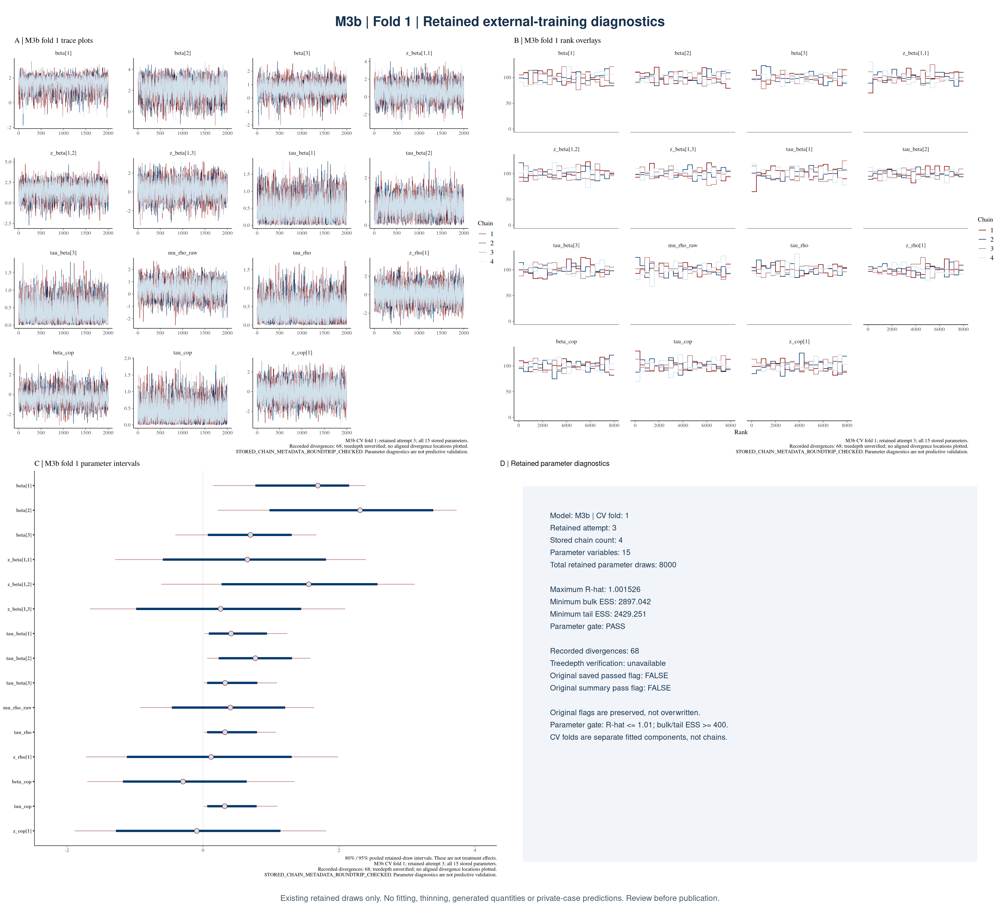
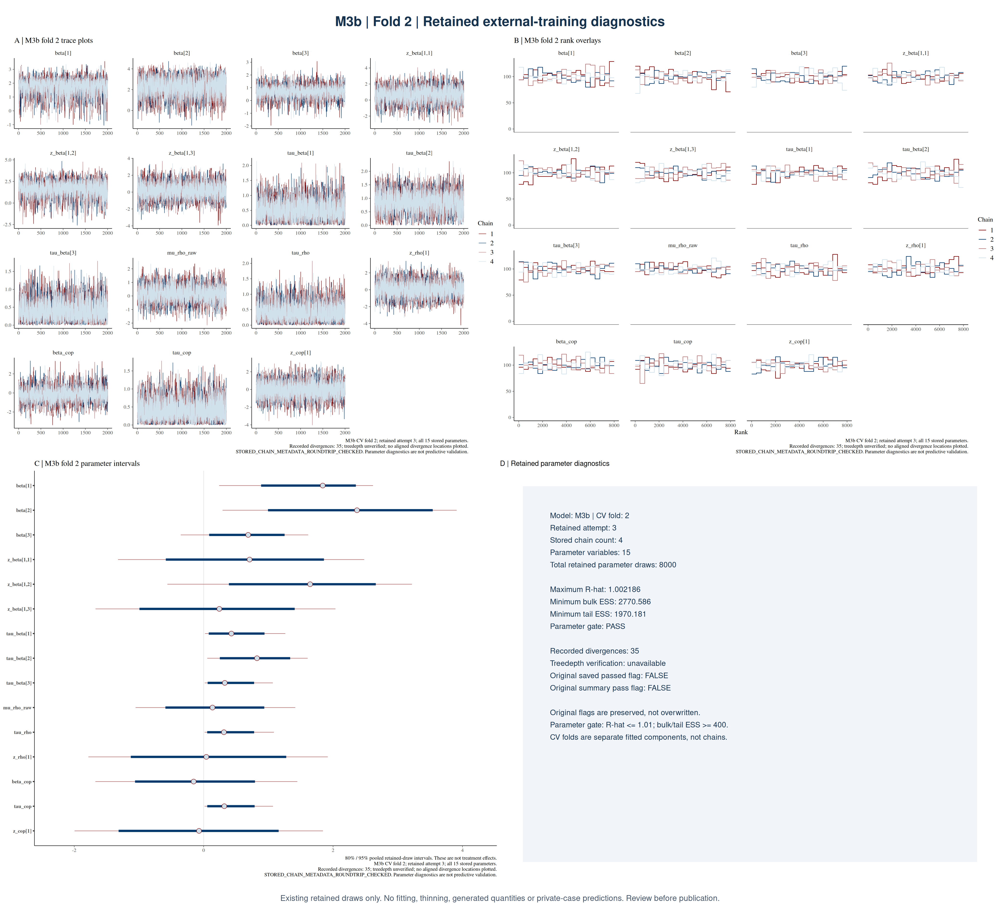

# M3b — retained external-training fits

[Stan model source](../../workflow/stan/m3b.stan)

## Diagnostic values

| Fold | Attempt | Chains | Draws | Max R-hat | Min bulk ESS | Min tail ESS | Parameter gate | Divergences | Count / draws |
|---:|---:|---:|---:|---:|---:|---:|---|---:|---:|
| 1 | 3 | 4 | 8,000 | 1.001526 | 2897.0 | 2429.3 | PASS | 68 | 0.85% |
| 2 | 3 | 4 | 8,000 | 1.002186 | 2770.6 | 1970.2 | PASS | 35 | 0.44% |
| 3 | 1 | 4 | 4,000 | 1.004117 | 1422.9 | 951.1 | PASS | 64 | 1.60% |

Parameter diagnostics are not predictive validation. Recorded divergences remain qualified, treedepth is unverified, and conflicting historical summaries are preserved separately.

Count / draws means recorded divergences divided by retained parameter draws. A verified post-warmup transition rate requires the same retained attempt and unthinned draws.

## Overview

## Fold 1

[Trace](figures/m3b_fold01_trace.png) · [Rank](figures/m3b_fold01_rank.png) · [Intervals](figures/m3b_fold01_intervals.png)

## Fold 2

[Trace](figures/m3b_fold02_trace.png) · [Rank](figures/m3b_fold02_rank.png) · [Intervals](figures/m3b_fold02_intervals.png)

## Fold 3

[Trace](figures/m3b_fold03_trace.png) · [Rank](figures/m3b_fold03_rank.png) · [Intervals](figures/m3b_fold03_intervals.png)

## Analysis role

M3b supplies the three equally weighted components of the frozen deployment predictor.

Each CV fold is a separate fit with its own chains. This batch does not yet include verified training/scoring entrypoints or their full dependency closure. No complete run command is claimed. PNG table export remains a separate reviewed addition.

## Individual fold pages

- [Fold 1: panel and individual plots](folds/fold01/README.md)
- [Fold 2: panel and individual plots](folds/fold02/README.md)
- [Fold 3: panel and individual plots](folds/fold03/README.md)
